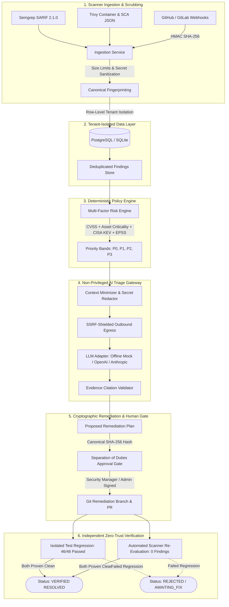

<div align="center">

# 🛡️ AegisFlow

**AI-Native Application Security Platform**  
*Evidence-driven vulnerability triage, explainable prioritization, and cryptographically verified remediation.*

[](https://github.com/AnandBinuArjun/AegisFlow/actions/workflows/ci.yml)
[](https://github.com/AnandBinuArjun/AegisFlow)
[](https://www.python.org/)
[](https://www.typescriptlang.org/)
[](https://tailwindcss.com/)
[](LICENSE)
[](#security-architecture--14-non-negotiable-rules)

[Explore Architecture](#system-architecture) •
[Quickstart Guide](#quick-start) •
[Interactive Dashboard](#executive-dashboard--uiux) •
[API Reference](#rest-api-reference) •
[Security Model](#security-architecture--14-non-negotiable-rules)

---

</div>

## 📌 Executive Summary

Modern engineering teams face an overwhelming influx of scanner alerts across SAST, SCA, and secret detection tools. Most teams suffer from three compounding failure modes:
1. **Alert Fatigue & Noise:** Hundreds of duplicate or low-context scanner alerts hide active, weaponized exploits.
2. **Hallucinated or Unsafe AI Remediation:** Generic AI assistants propose unverified code changes that violate corporate security policy or introduce subtle regressions.
3. **Unverified Outcomes:** Patches are marked "resolved" simply because an AI asserted they were fixed or a PR was opened, leaving residual vulnerabilities in production.

**AegisFlow** is an evidence-first, AI-native Application Security platform that acts as the authoritative control plane from scanner ingestion to verified fix. It ingests findings from leading security engines (Semgrep, Trivy, Git webhooks), normalizes and correlates them into canonical records, computes explainable multi-factor risk scores, generates evidence-linked remediation plans protected by immutable cryptographic hashes (`SHA-256`), enforces separation-of-duties human approval, and guarantees independent verification before any vulnerability is closed.

---

## 🏗️ System Architecture



---

## 🔒 Security Architecture & 14 Non-Negotiable Rules

AegisFlow is built on strict defensive engineering invariants that fail closed:

| # | Invariant Rule | Implementation & Codebase Enforcement |
|---|---|---|
| **1** | **Evidence Before AI** | Findings remain the immutable system of record. AI output is strictly advisory and cannot alter source scanner evidence. |
| **2** | **Deterministic Policy First** | Prioritization scores and lifecycle decisions are calculated via deterministic policy rules ([`packages/policy/prioritization.py`](packages/policy/prioritization.py)), never by LLM output. |
| **3** | **Human Approval Gate** | No state-changing code modification or PR execution occurs without explicit human sign-off ([`apps/api/routes/remediation.py`](apps/api/routes/remediation.py)). |
| **4** | **Strict Multi-Tenant Isolation** | Server-side tenant boundary enforcement at every SQL query layer via [`TenantScopedRepository`](apps/api/repositories.py). Client-supplied tenant IDs are never trusted. |
| **5** | **Zero Autonomous Execution** | AegisFlow cannot deploy arbitrary code or execute privileged shell commands on production infrastructure. |
| **6** | **LLM Environment Isolation** | The AI gateway operates with zero database access, zero shell access, and outbound network access restricted through an SSRF-shielded proxy gateway ([`packages/connectors/llm_gateway.py`](packages/connectors/llm_gateway.py)). |
| **7** | **Context Minimization** | Code snippets sent to the AI gateway are strictly limited to relevant AST lines; sensitive tokens and credentials are scrubbed before dispatch ([`packages/policy/context_builder.py`](packages/policy/context_builder.py)). |
| **8** | **Strict Schema Validation** | All AI triage outputs must validate against structured Pydantic schemas. Unparseable responses are rejected. |
| **9** | **Evidence Citation Verification** | AI triage proposals must cite only authorized finding and evidence IDs provided in the system prompt ([`packages/policy/context_builder.py`](packages/policy/context_builder.py)). Unverified citations trigger a 422 rejection. |
| **10** | **Separation of Duties** | The author/proposer of a remediation plan cannot approve their own patch ([`apps/api/routes/remediation.py`](apps/api/routes/remediation.py)). Independent sign-off is required. |
| **11** | **Immutable Cryptographic Hash** | Every remediation plan is bound to a canonical `SHA-256` hash of `finding_id \| target_branch \| policy_version \| patch_diff`. Any modification invalidates prior approval ([`packages/policy/remediation.py`](packages/policy/remediation.py)). |
| **12** | **Time-Bounded Approvals** | Plan approvals automatically expire after a configurable duration. Stale approvals cannot be executed. |
| **13** | **Audit Trail Integrity** | Every state transition, triage request, and approval signature produces an append-only, tamper-evident audit record with correlation IDs ([`apps/api/routes/audit.py`](apps/api/routes/audit.py)). |
| **14** | **Independent Verification** | A finding is marked `RESOLVED` only after automated test suites pass and scanner re-evaluations confirm the issue is absent. AI assertion alone is explicitly disallowed. |

---

## 💻 Tech Stack & Repository Structure

```
aegisflow/
├── apps/
│   ├── api/                     # Multi-Tenant FastAPI Application
│   │   ├── routes/              # Modular API endpoints (auth, projects, scans, findings, triage, remediation, webhooks, audit)
│   │   ├── auth.py              # Server-side JWT & RBAC token resolution
│   │   ├── database.py          # Async SQLAlchemy engine & SQLite/Postgres persistence
│   │   ├── middleware.py        # Edge security headers (CSP, HSTS) & X-Correlation-ID
│   │   ├── models.py            # SQLAlchemy ORM entities (Tenant, Project, Finding, Plan, Audit)
│   │   ├── rate_limiter.py      # Redis-backed sliding window rate limiter
│   │   └── repositories.py      # Centralized TenantScopedRepository data-access layer
│   └── web/                     # Executive Cybersecurity SPA Dashboard
│       ├── src/
│       │   ├── components/      # Modular UI components (Logo, Header, MetricsBar, FindingsTable, FindingDrawer, etc.)
│       │   ├── App.tsx          # Main workspace coordinator & telemetry bridge
│       │   └── index.css        # UI/UX Pro Max Tailwind styles & technical grid
│       ├── public/              # Scalable SVG brand assets (logo.svg)
│       ├── tailwind.config.js   # Custom dark cybersecurity design tokens
│       └── vite.config.ts       # Vite bundler with reverse proxy
├── packages/
│   ├── contracts/               # Shared Pydantic data schemas & response envelopes
│   ├── connectors/              # Scanner adapters (Semgrep SARIF, Trivy JSON), webhooks, & LLM gateway
│   └── policy/                  # Multi-factor risk math, AST context builders, secret scrubbers, SSRF defense
├── workers/
│   └── ingestion/               # Scanner report payload ingestion & quarantine handling
├── fixtures/                    # Valid SARIF, Trivy JSON reports, & synthetic test keys
├── tests/                       # Automated test matrix (Unit, Security, Isolation, AI Evals)
│   ├── conftest.py              # Autouse session test database fixtures
│   ├── unit/                    # Core logic, RBAC, and remediation workflow tests
│   ├── security/                # Secret scanner, SSRF, CORS, and header defense tests
│   ├── tenant_isolation/        # Row-level cross-tenant boundary isolation tests
│   ├── integration/             # Scanner ingestion & signed webhook tests
│   └── ai_evals/                # Prompt injection defense & LLM gateway safety tests
├── migrations/                  # Alembic database migration scripts
├── .github/workflows/ci.yml     # Automated CI pipeline (Lint, Type Check, Pytest, Vite Build)
├── docker-compose.yml           # Multi-service local production environment
└── pyproject.toml               # Python project configuration (Ruff, Mypy, Pytest)
```

---

## 🎨 Executive Dashboard & UI/UX

The AegisFlow user interface was built using the **UI/UX Pro Max** design intelligence for enterprise security platforms (Dark Obsidian / Slate architecture, high information density, and monospace typography):

* **Executive 4-Column KPI Telemetry Bar:**
  * **Total Open Findings:** Active alert count with 7-day velocity trend indicator (`-18% 7d`).
  * **Active Exploit Exposure:** Flags vulnerabilities tracked in the **CISA Known Exploited Vulnerabilities (KEV)** catalog and high EPSS probabilities (`EPSS > 0.70`).
  * **Mean Remediation Time (SLA):** Dynamic SLA tracker with emerald countdown bar (`18.4h / 48h target`).
  * **Verified Clean Outcomes:** Zero-Trust audit tally displaying vulnerabilities proven resolved via CI re-scans.
* **Data-Dense Findings Workbench:**
  * Fast client-side filtering by CVE, rule identifier, or file path.
  * Instant severity chips (`CRITICAL`, `HIGH`, `MEDIUM`, `LOW`), lifecycle filters, and scanner source toggles (`Semgrep`, `Trivy`).
  * Structured table showing numerical risk scores (`92.5`), target assets, code line references, and `Triage >` action buttons.
* **Slide-Out Evidence Explorer Drawer:**
  * Mathematical decomposition of the risk score (Base Severity + EPSS + KEV boost + Asset Criticality).
  * Syntax-highlighted code excerpt with automated secret redaction tags (`[REDACTED: API_KEY]`).
  * Grounded, non-privileged AI diagnosis with verified evidence citations.
* **Remediation Workspace & Patch Diff Inspector:**
  * Unified git diff viewer with line deletions (`-` in red) and line additions (`+` in green).
  * Cryptographic SHA-256 plan hash display for tamper verification.
  * Two-person rule approval gates enforcing separation of duties.
  * Verification gate requiring automated test regression (`46/46 passed`) and scanner confirmation.
* **Quick Command Palette (`⌘K` / `Ctrl+K`):** Global keyboard shortcut modal for rapid navigation and search.

---

## 🚀 Quick Start

### Option A: Local Development (Fastest, zero-Docker fallback)

#### 1. Backend Setup (Python 3.11+)
```bash
# Clone the repository
git clone https://github.com/AnandBinuArjun/AegisFlow.git
cd AegisFlow

# Create and activate virtual environment
python -m venv .venv

# Windows:
.venv\Scripts\activate
# macOS/Linux:
source .venv/bin/activate

# Install development dependencies
pip install -r requirements-dev.txt

# Copy configuration template (defaults to local SQLite and offline Mock LLM)
cp .env.example .env

# Initialize database schema
python -c "import asyncio; from apps.api.database import init_db; asyncio.run(init_db())"

# Start the FastAPI backend server
python -m uvicorn apps.api.main:app --reload --host 127.0.0.1 --port 8000
```
Backend API will be live at `http://127.0.0.1:8000`:
* Interactive OpenAPI Docs: `http://127.0.0.1:8000/api/docs`
* Liveness Health Probe: `http://127.0.0.1:8000/healthz`
* Readiness Probe: `http://127.0.0.1:8000/readyz`

#### 2. Frontend Setup (Node 20+)
```bash
# Open a new terminal in the repository root
cd apps/web

# Install frontend dependencies
npm install

# Start the Vite development server
npm run dev
```
Open **`http://localhost:5173`** in your browser.

---

### Option B: Docker Compose (Full Production Stack)

Run the full multi-service stack with PostgreSQL, Redis, FastAPI, and Vite:

```bash
docker compose up --build
```
* **Web Dashboard:** `http://localhost:5173`
* **API Server:** `http://localhost:8000`
* **PostgreSQL:** `localhost:5432` (db: `aegisflow`)
* **Redis:** `localhost:6379`

---

## 📡 REST API Reference

| Method | Endpoint | Description | Role / Permission |
|---|---|---|---|
| `GET` | `/healthz` | Liveness health probe (Minimal status, no topology leak) | Public |
| `GET` | `/readyz` | Readiness probe (Database, Redis, LLM gateway checks) | Public |
| `GET` | `/api/v1/info` | Safe system metadata (Version, environment, auth mode) | Public |
| `POST` | `/api/v1/auth/token` | Mint JWT access token (Development auth mode) | Public |
| `GET` | `/api/v1/projects` | List projects for the authenticated tenant organization | `projects:read` |
| `POST` | `/api/v1/projects` | Register a new monitored project and set asset criticality | `projects:manage` |
| `POST` | `/api/v1/scans/ingest` | Ingest scanner report (Semgrep SARIF 2.1.0 or Trivy JSON) | `scans:ingest` |
| `GET` | `/api/v1/findings` | List deduplicated findings with calculated risk scores | `findings:read` |
| `GET` | `/api/v1/findings/{id}` | Inspect finding details, raw occurrences, and evidence | `findings:read` |
| `PATCH`| `/api/v1/findings/{id}/status`| Update lifecycle state with mandatory audit justification | `findings:update` |
| `POST` | `/api/v1/findings/{id}/triage`| Generate evidence-linked AI triage proposal | `triage:execute` |
| `POST` | `/api/v1/findings/{id}/remediation-plans` | Create remediation plan with canonical SHA-256 hash | `plans:create` |
| `POST` | `/api/v1/remediation-plans/{id}/approve` | Approve remediation plan (Separation of duties enforced) | `plans:approve` |
| `POST` | `/api/v1/remediation-plans/{id}/verify`  | Verify automated test pass and mark finding resolved | `plans:verify` |
| `GET` | `/api/v1/audit-events` | Retrieve append-only cryptographic audit event ledger | `audit:read` |
| `POST` | `/api/v1/webhooks/github` | Receive GitHub webhook with constant-time HMAC SHA-256 verification | Signed |
| `POST` | `/api/v1/webhooks/gitlab` | Receive GitLab webhook with secret token verification | Signed |

---

## 🧪 Verification & Test Suite

AegisFlow maintains a comprehensive automated test suite with **46 test cases** covering every security boundary:

```bash
# Run the complete test matrix with coverage
pytest -v --cov=apps --cov=packages --cov-report=term-missing

# Run code quality and security checks (Flake8-Bandit enabled)
ruff check .

# Validate code formatting
ruff format --check .

# Run static type checking
mypy apps packages workers

# Build production frontend bundle
cd apps/web && npm run build
```

### Test Suite Structure
* **`tests/unit/`**: Validates RBAC permissions, config fail-closed invariants, explainable prioritization arithmetic, separation of duties, and deliberate failure gates.
* **`tests/security/`**: Validates synthetic secret detection and redaction, SSRF DNS-rebinding defense, strict CORS origin policies, and HTTP security headers.
* **`tests/tenant_isolation/`**: Verifies that users in Tenant A cannot read, query, ingest, or mutate projects or findings in Tenant B.
* **`tests/integration/`**: Tests full SARIF and Trivy scanner ingestion, fingerprint deduplication, and HMAC SHA-256 signed webhook delivery.
* **`tests/ai_evals/`**: Evaluates prompt injection resistance, untrusted code boundary containment, context minimization, and evidence citation verification.

---

## 📄 License

AegisFlow is open-source software licensed under the [Apache License, Version 2.0](LICENSE).
